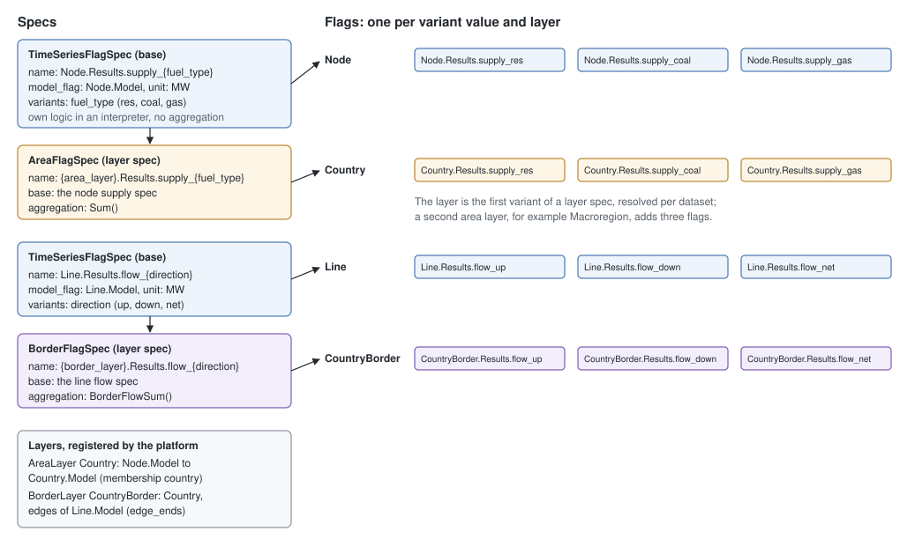

# Flags and layers

A flag spec declares one variable. The fetch path, the flag index and the describe methods read it. Classes, fields and signatures are in the API reference: [Flag System](../api_reference/flag.md), [Layer Flags](../api_reference/layer_flags.md), [Units](../api_reference/units.md).



The figure shows a line flow spec with one variant dimension, `direction`. The code below and the synthetic platform use two, `flow_{side}_{direction}`.

## 1. Specs

**Base specs** have their own logic, one class per item type: `ModelFlagSpec` (the model table of one object type, `Node.Model`), `TimeSeriesFlagSpec` (usually one column per object of a model flag, `Node.Results.price`) and `OtherFlagSpec` (any other table). **Layer specs** name a base spec and an aggregation: `AreaFlagSpec` (`{area_layer}.Results.price`) and `BorderFlagSpec` (`{border_layer}.Results.price_spread`).

```python
LINE_FLOW_SPEC = TimeSeriesFlagSpec(
    name='Line.Results.flow_{side}_{direction}',
    description='Power flow on the line.',
    unit=Units.MW,
    model_flag='Line.Model',
    variants=(SIDE, DIRECTION),
    fill_value=0,
)


class LineInterpreter(MyInterpreterBase):
    flag_specs = (LINE_MODEL_SPEC, LINE_FLOW_SPEC)

    def _fetch(self, flag, effective_config, **params):
        ...
```

- **Flag names.** The flag grammar belongs to the platform. mesqual only fills in the `{placeholders}` of a name template, one per variant dimension. Everything mesqual needs comes from spec fields (`model_flag`, `topology_type`, ...), never from the name.
- **Checks.** `__post_init__` checks the spec itself: `quantity_type` only for an ambiguous unit, placeholders match the variant dimensions, dimension names are unique, `edge_ends` only on an `Edge` model spec. Instance creation checks the references: `model_flag` names a `ModelFlagSpec` or a layer model of the index that answers the fetch. A platform dataset and a link collection check this on their full index at construction; another dataset checks its own index in its outermost fetch.
- **No raw names.** A spec names no raw tables or columns, and it does not list the flags it fetches: availability comes from the interpreter ([other-contracts.md](other-contracts.md#describe-and-availability)), dependencies are recorded at runtime ([core-contracts.md](core-contracts.md#2-fetch)).
- **Same spec.** Two specs are the same when their class, name, dimensions, `version` and class fields are equal; for layer specs also the base and the aggregation (`same_as`). Two specs of one name that are not the same raise in a collection and in a flag index. A name that two answering interpreters declare raises `AmbiguousOverrideError`.
- **Flag index.** `FlagIndex` maps a flag name to its spec. `FlagIndex` has no implicit rules.

## 2. Dimensions: variants and parameters

One class, `Dimension`, for both roles. A spec lists it in `variants=` or `params=`; a dataset class lists its own in `fetch_params` (dataset parameters).

| | Variant | Parameter |
|---|---|---|
| In the flag name | Yes, as a placeholder | No |
| Each value is | its own flag | a setting of the same flag |
| Values | finite, each with a description | finite with descriptions, or open with `validate` |
| Set by | the flag name | fetch argument, then `param_defaults`, then the dimension default |

- **Variants.** `spec.expand(dataset)` gives the flag names, `spec.variant_of(flag)` the values with attribute access (`v.direction`). Each flag stays a normal flag name: `fetch`, the cache and comparisons do not know about variants.
- **Flag families.** A variant whose `values` is a function of the dataset gives a family, for example `Node.Results.generation_{fuel}` with the fuels of `Generator.Model`. The function may fetch model flags, never time series flags. `flag_is_accepted` matches the template without calling it; `fetch` and the describe methods call it. A function that needs an unavailable flag gives no values, so the family has no flags on that dataset; any other error raises.
- **Parameters.** A missing `REQUIRED` value or a value outside `values` raises `ValueError`. A `bool` matches only a `bool` value. The resolved parameters go to `_fetch` as keyword arguments and into the cache key.
- **One owner.** Every keyword argument of `fetch` except `granularity` is a parameter of the spec of the flag or of the dataset class, for example `comparison_type` of `DatasetComparison`. A keyword argument that neither declares raises `ValueError`, and a name with two owners in one dataset raises at construction. A class has the `fetch_params` of its base classes.
- **Collections** resolve only their own dataset parameters. They pass the flag parameters of the call on, and pass each child the dataset parameters that the child accepts and that the call or the `param_defaults` of the collection gave, never a dimension default. So a child gives the same result inside the collection as alone.
- **Typed `fetch`.** A subclass may override `fetch` only to add typed keyword-only arguments for its dataset parameters, default `UNSET`, and passes on only the arguments that are not `UNSET`.

## 3. New spec, variant or parameter

Ask in this order; the first "yes" decides:

| Question | Yes | Example |
|---|---|---|
| Do the logic, the unit or the quantity type differ? | New spec | A price and a volume of one object. |
| Is it another quantity that a user shows next to the original, and does one implementation cover all values? | Variant | Flow `up`, `down` and `net`; supply per fuel type (`res`, `coal`, `gas`); area layers. |
| Does it select how the same quantity is computed, usually one setting per study? | Parameter | Which solution of a run to read (`first`, `final`); how losses count in a trade balance. |
| Is it one more categorical axis of one result that users want in one frame? | `dimension` level in the schema | `exp`, `imp`, `net_exp` of a trade balance. |

- **Every value explicitly.** Interpreters and aggregations handle each variant and parameter value with one branch or lookup entry. `fetch` checks the values before `_fetch`, so a lookup is enough. An aggregation raises `ValueError` for a value that it does not know or cannot aggregate (a border sum of `max(up, down)` is not the sum of the line maxima). So a new value fails loudly until its code exists. A platform package fetches every flag of every spec with every parameter value in one test, as the tests of `mesqual.testing` do.
- **Derived variants.** One spec per name pattern. The interpreter computes derived values (`net = up - down`) in the same spec and fetches the source values through `parent_dataset.fetch`, so an override of a source value reaches them.

## 4. Values, units, schema, topology, memberships

- **Fill value.** `fill_value` is the value for an object or row that one side of a sum or comparison lacks; `None` or NaN means no fill. A comparison may override it with its dataset parameter `fill_value`.
- **Quantity type.** The unit registry gives each unit `INTENSIVE` or `EXTENSIVE` (`UNKNOWN` for `NaU`, `MissingUnit` and units outside the registry). A spec sets `quantity_type` only for a unit that a platform marked `AMBIGUOUS` with `Units.register_quantity_type`. No unit in `Units` is `AMBIGUOUS`. The quantity type decides how the granularity conversion treats a flag. The type of each unit is in the docstring of `Units.get_quantity_type_enum` ([Units](../api_reference/units.md)).
- **Schema.** `FrameSchema` declares the index and column levels, each with a name (or `None`: unnamed) and a role: `time`, `object`, `counterpart`, `object_from`, `object_to`, `dimension`, `dataset` (added by collections). A time series spec has the default schema `(time: time)` x `(<index of its model>: object)`; a model spec `(<index>: object)` x `(None: dimension)`; a layer spec the base schema with the object level renamed to the `index` of the layer. An `OtherFlagSpec` and a time series spec with `model_flag=None` declare their schema. `schema` may be a function of the variant values (and of the layer, on a layer spec).
- **Topology types.** A model spec declares its topology type; a time series spec takes it from its model spec. `Node` and `NodeConnectedElement` aggregate to `Area`, `Edge` to `Border`; an `Area` flag can give a `Border` flag (a price spread), a `Border` flag an `Area` flag (a trade balance). The two areas of a border need not be neighbours. The visualization type follows from the topology type unless the spec sets it.
- **Memberships.** A model spec declares which columns refer to other model flags (`memberships={'country': 'Country.Model'}`) and, for an `Edge` model, its two ends (`edge_ends=('node_from', 'node_to')`, in line direction). Memberships are the only place where these column names appear.

## 5. Layers

An area layer groups the objects of one type into areas; a border layer gives the borders between the areas of an area layer, with the edges that cross them. The platform registers both and declares every layer spec.

```python
MyPlatformDataset.register_area_layer(AreaLayer(
    name='Country', index='country', base_model='Node.Model', layer_model='Country.Model',
    description='Countries of the nodes.',
))
MyPlatformDataset.register_border_layer(BorderLayer(
    name='CountryBorder', index='country_border', area_layer='Country', edge_model='Line.Model',
    description='Borders between two countries, crossed by lines.',
))

AREA_PRICE_SPEC = AreaFlagSpec(
    name='{area_layer}.Results.price',
    base=NODE_PRICE_SPEC,
    aggregation=WeightedMean(weight='Node.Results.demand'),
    description='Demand-weighted mean of the node prices of the area.',
)
BORDER_FLOW_SPEC = BorderFlagSpec(
    name='{border_layer}.Results.flow_{side}_{direction}',
    base=LINE_FLOW_SPEC,
    aggregation=BorderFlowSum(),
    description='Sum of the line flows across the border, in border direction.',
)


@MyPlatformDataset.register_interpreter
class MyAreaFlags(AreaFlagInterpreter):
    flag_specs = (AREA_PRICE_SPEC,)
```

**Layers.**

- Several area layers can group the same objects in different ways, for example `Country` and a custom `Macroregion`. A base object with an empty value in the membership column belongs to no area.
- Layers are registered per class and resolved along the MRO, like interpreters; a study subclass can add more. The platform declares the layer model flags too (`AreaModel`, `BorderModel` or source tables).

**Layer specs.**

- A layer spec takes item type, unit, quantity type and `fill_value` from its base, its topology type from its class. Its first variant dimension is the layer, named by `layer_placeholder` (default `area_layer` or `border_layer`) and resolved per dataset. The spec has the variant dimensions of the base, without the consumed ones and without the layer dimension of a layer base. Its layer dimension takes all matching layers. `consumes` names base dimensions that the aggregation resolves itself; the availability check then reads the base flag of their first values only, so the aggregation lists the other base flags it fetches in `input_flags`.
- A layer spec on a layer spec of its own class raises `TypeError`.
- The base parameters stay; `params` adds parameters of the aggregation, which go to `aggregate` only. A layer flag passes each nested fetch only the parameters that the spec of that flag declares.
- A time series spec with a `model_flag` template (`'{area_layer}.Model'`) is for a platform that reads area values from its source.

**Interpreters and aggregations.**

- `AreaFlagInterpreter` and `BorderFlagInterpreter` fetch the base flag and the mapping (base model or border model) through `parent_dataset.fetch`, so overrides of the base reach the layer flags, and call `aggregate`. A spec that consumes base dimensions gets `values=None`: the interpreter does not fetch the base flag, and the aggregation fetches what it needs. Only a model spec on a node base always gets the base model. An aggregation on a node or node-connected base (area spec) or an edge base (border spec) maps one object level; an area spec on a border base gets the border model and may build several column levels ([example-trade-balance.md](example-trade-balance.md)).
- A layer flag is available when the flags its fetch reads are available: the base flag, the base or border model, and the `input_flags` of the aggregation. The reason names the deciding inputs.
- An aggregation is a frozen dataclass with a `version` (part of the version identity). It lists the flags it fetches besides the base in `input_flags`, and checks the spec at declaration in `check_spec`. A platform or study subclasses `AreaAggregation` or `BorderAggregation` for special cases.
- `aggregate(values, mapping, dataset, layer, variant, effective_config, **params)` gets the platform dataset and the `effective_config` of the layer flag fetch; a `BorderAggregation` gets the border model in place of `mapping`. It passes `effective_config` to each fetch, as an interpreter does: `dataset.fetch(flag, effective_config)`, or `self.fetch(dataset, flag, effective_config, params)`, which also leaves out the parameters that the spec of `flag` does not declare.

`describe_class_flags()` and `describe_flags()` list a layer spec once, with its layers and their model flags. `describe_class_area_layers()` and `describe_class_border_layers()` list each layer once. `objects_without_area(dataset, layer)` and `edges_on_no_border(dataset, layer)` count what a layer leaves out.
