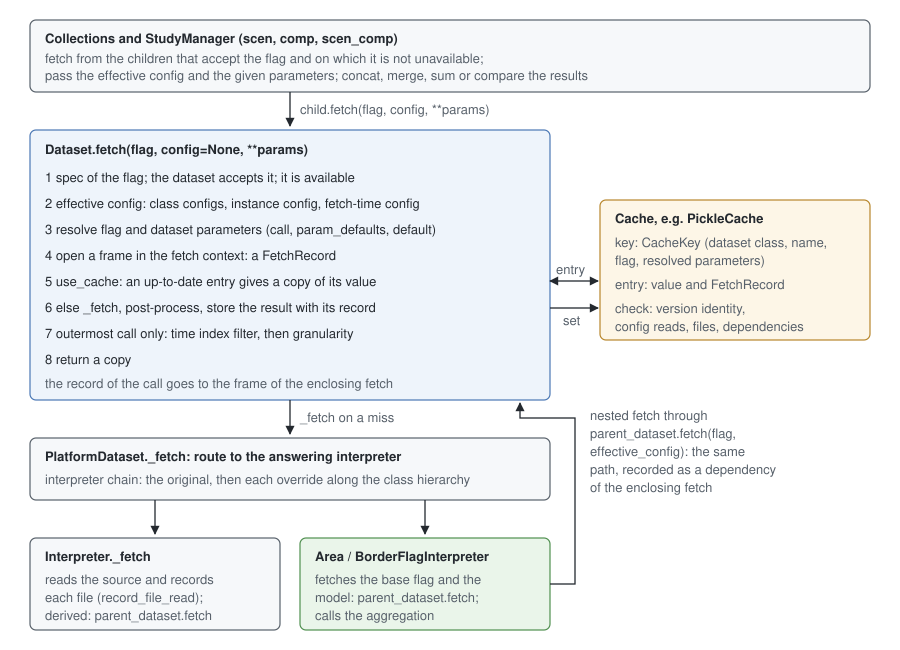

# Architecture

mesqual is a generic framework for multi-scenario analysis of energy market simulations. A platform package reads the results of one simulation platform and builds on the contracts of these pages; a study builds on a platform package. These pages are for developers and agents who use or extend the API.

mesqual stays generic. It knows datasets, flags, configs, collections, units, layers and caches. It does not know the concepts of a platform, for example how a platform splits its results into several datasets. A platform package maps those concepts onto datasets, flags and flag parameters.

## Parts

- **Datasets** answer flags: `fetch(flag)` returns a frame. A platform dataset routes each flag to an **interpreter**, its child dataset for a part of the source. The **config** sets fetch options in layers; **collections** combine datasets into scenarios, comparisons and a study (`StudyManager`). See [core-contracts.md](core-contracts.md).
- **Flag specs** declare each flag: name, description, unit, variants, parameters, schema. **Area and border layers** turn node and line flags into area and border flags. See [flags-and-layers.md](flags-and-layers.md).
- **Interpreter overrides**, **describe methods and availability**, the **cache** (a `Cache` that stores results with the record of each fetch), **validation** and **KPIs**: see [other-contracts.md](other-contracts.md).
- A worked example adds a trade balance per area and partner to the synthetic platform `mesqual.testing`: see [example-trade-balance.md](example-trade-balance.md).

## Principles

- **Explicit, not inferred.** A flag exists because a spec declares it. Unit, quantity type and aggregation come from the specs and the unit registry. mesqual has no default aggregation, does not parse flag names and does not detect variables. An unknown flag raises.
- **One source per fact.** The flag spec is the only place that describes a flag.
- **No order dependence.** The result of a registration does not depend on the import or registration order. An ambiguous registration raises.
- **Cheap introspection.** The describe methods never load time series data.

## Classes and modules

| Class or function | Module | Page |
|---|---|---|
| `Dataset`, `PlatformDataset`, `DatasetConfig`, `config_field`, `TimeIndexFilter`, `FetchRecord`, `SourceInventory`, `Availability` | `mesqual.datasets` | [core contracts](core-contracts.md) |
| `DatasetLinkCollection`, `DatasetMergeCollection`, `DatasetConcatCollection`, `DatasetSumCollection`, `DatasetComparison` | `mesqual.datasets` | [core contracts](core-contracts.md) |
| `StudyManager` | `mesqual` | [core contracts](core-contracts.md) |
| `ModelFlagSpec`, `TimeSeriesFlagSpec`, `OtherFlagSpec`, `Dimension`, `FrameSchema`, `Level`, `FlagIndex` | `mesqual.flag` | [flags and layers](flags-and-layers.md) |
| `AreaLayer`, `BorderLayer`, `AreaFlagSpec`, `BorderFlagSpec` | `mesqual.flag` | [flags and layers](flags-and-layers.md) |
| `AreaFlagInterpreter`, `BorderFlagInterpreter`, `AreaAggregation`, `BorderAggregation` | `mesqual.layer_flags` | [flags and layers](flags-and-layers.md) |
| `Units`, `QuantityTypeEnum` | `mesqual.units`, `mesqual.enums` | [flags and layers](flags-and-layers.md) |
| `PlatformDataset.register_interpreter`, `PlatformDataset.get_answering_interpreter` | `mesqual.datasets` | [other contracts](other-contracts.md) |
| `Cache`, `PickleCache`, `CacheKey` | `mesqual.cache` | [other contracts](other-contracts.md) |
| `DatasetCheck`, `DatasetValidator`, `ValidationReport` | `mesqual.validation` | [other contracts](other-contracts.md) |
| `KPIDefinition`, `CustomKPIDefinition`, `FlagAggKPIBuilder` | `mesqual.kpis` | [other contracts](other-contracts.md) |
| `DummyDataset`, `make_dummy_study` | `mesqual.testing` | [Synthetic Test Data](../api_reference/testing.md) |
